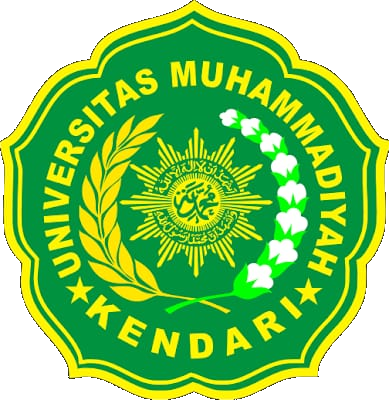
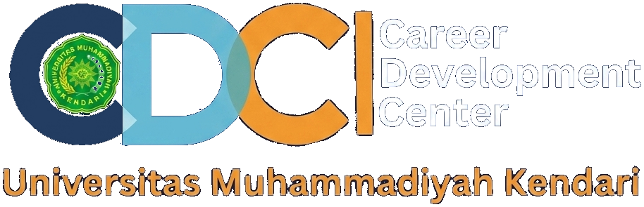

<div align="center">
  
  &nbsp;&nbsp;&nbsp;&nbsp;&nbsp;&nbsp;&nbsp;&nbsp;&nbsp;&nbsp;&nbsp;&nbsp;
  

  # PORTAL CAREER DEVELOPMENT CENTER (CDC)
  ### Universitas Muhammadiyah Kendari

  <p align="center">
    <b>Platform Terpadu Pengembangan Karir Mahasiswa, Informasii Lowongan & Internship, Layanan Konseling, serta Penjejakan Alumni (Tracer Study).</b>
  </p>

  [](https://reactjs.org/)
  [](https://www.typescriptlang.org/)
  [](https://vitejs.dev/)
  [](https://tailwindcss.com/)
  [](LICENSE)
</div>

---

## 📌 Tentang Portal CDC UM Kendari

**Portal Career Development Center (CDC) Universitas Muhammadiyah Kendari** merupakan platform berbasis web modern yang dirancang khusus sebagai pusat inkubasi karir, penjaminan mutu lulusan, dan jembatan strategis antara mahasiswa/alumni Universitas Muhammadiyah Kendari dengan dunia kerja serta industri global.

Platform ini mengintegrasikan seluruh layanan pengembangan potensi diri, akses bursa kerja (*job placement*), konseling karir personal, program sertifikasi & workshop, hingga evaluasi penjejakan alumni (*Tracer Study*) secara real-time.

---

## ✨ Fitur-Fitur Utama Sistem

Portal CDC UM Kendari memiliki 4 (empat) modul utama yang saling terintegrasi:

### 1. 🌐 Portal Informasi Publik (Public Portal)
- **Hero Interactive Banner**: Carousel pengumuman strategis dan program kerja utama CDC.
- **Info Karir CDC Terkini**:
  - **Lowongan By Admin**: Poster lowongan buatan Admin ditampilkan dengan gaya *Full-Bleed Center-Crop Zoom* yang memukau dan fokus pada informasi utama.
  - **Lowongan By Mitra**: Tampilan logo perusahaan mitra dengan box ber-padding proporsional (*Contain Mode*).
- **Berita & Artikel Karir**: Publikasi artikel tips karir, berita kampus, dan artikel informatif.
- **Program & Pengumuman**: Pengumuman penting, program intensif (seperti *Job Preparation*), dan event kampus.
- **Popular Info Widget**: Informasi terpin (*Pinned Content*) yang sering diakses pengguna.
- **Layanan Cepat**: Akses instan ke **Konseling Karir** dan **Tes Potensi Minat Kerja (Klob Meter)**.
- **Profil & Visi Misi CDC**: Profil resmi UPT Pengembangan Kreativitas, Inovasi & Konseling Mahasiswa.

### 2. 🎓 Portal Mahasiswa, Alumni & Job Seeker
- **Manajemen Profil Mandiri**: Data pribadi, riwayat pendidikan, IPK, keahlian (*skills*), sertifikat, dan pengalaman kerja.
- **E-Lamar Lowongan & Magang**: Pendaftaran lowongan kerja atau program *internship* langsung melalui sistem.
- **Tracking Seleksi Multi-Stage**: Pemantauan status lamaran secara transparan (Administrasi, Interview, Diterima, Ditolak) beserta detail jadwal interview.
- **Form Tracer Study Online**: Pengisian survei penjejakan alumni untuk evaluasi mutu lulusan kampus.
- **Bukti Bebas Tracer CDC**: Generasi dokumen/bukti lulus tracer secara otomatis.

### 3. 🏢 Portal Mitra Perusahaan (Recruiter / Partner)
- **Posting & Kelola Lowongan**: Perekrut dapat memposting lowongan kerja (*Full-Time*, *Part-Time*) atau magang (*Internship*).
- **Management Pelamar Kerja**: Peninjauan berkas CV, transkrip, dan profil pelamar secara langsung.
- **Jadwal Interview & Seleksi**: Pengaturan jadwal interview online (Zoom/Meet) maupun offline serta pencatatan hasil evaluasi.
- **Survei Kepuasan Mitra**: Pengisian evaluasi kualitas lulusan UMK oleh instansi pengguna lulusan.

### 4. ⚙️ Portal Administrator CDC (CMS & Management System)
- **CMS Konten Karir Lengkap**:
  - Berita & Artikel Karir
  - Lowongan Info Karir By Admin
  - Program & Event (Workshop, Softskill, Seminar)
  - Presentasi / Prestasi Mahasiswa (Akademik & Non-Akademik)
  - Dokumen Resmi: SK (Surat Keputusan), Laporan Kinerja, MOU Stakeholder, Kalender Kegiatan, & Galeri Media.
- **Manajemen Pengguna & Verifikasi**: Persetujuan pendaftaran Mitra Perusahaan dan kontrol status akun.
- **Popular Info & Pinned Posts**: Pengaturan sematan informasi penting yang tampil di sidebar publik.
- **Adaptive Storage Engine**: Manajemen kuota penyimpanan lokal otomatis dengan kompresi gambar adaptif untuk menjamin stabilitas aplikasi.

---

## 🛠️ Teknologi & Stack Pengembangan

Application stack yang digunakan dalam pembangunan web ini:

- **Core Framework**: [React 18](https://reactjs.org/) (JavaScript / TypeScript)
- **Programming Language**: [TypeScript](https://www.typescriptlang.org/)
- **Build Tool**: [Vite](https://vitejs.dev/)
- **UI Components & Styling**:
  - Vanilla CSS3 & [Tailwind CSS](https://tailwindcss.com/)
  - Icons: [Lucide React](https://lucide.dev/)
  - Animation: [Framer Motion](https://www.framer.com/motion/)
- **Data Persistence**: LocalStorage Database Engine dengan penanganan kompresi gambar & auto-pruning.

---

## 🚀 Panduan Memulai & Pengoperasian Lokal

### Prasyarat
- [Node.js](https://nodejs.org/) (Versi 18.0.0 atau lebih baru)
- `npm` atau `yarn`

### Langkah-Langkah Instalasi

1. **Clone Repositori**:
   ```bash
   git clone https://github.com/akunrekantim-prog/PORTAL-CDC-UMK-KENDARI.git
   cd PORTAL-CDC-UMK-KENDARI
   ```

2. **Install Dependensi Proyek**:
   ```bash
   npm install
   ```

3. **Konfigurasi Environment**:
   Salin atau buat berkas `.env.local` pada direktori utama jika membutuhkan API Key eksternal (misal: Gemini AI API Key):
   ```env
   GEMINI_API_KEY=your_gemini_api_key_here
   ```

4. **Jalankan Server Development**:
   ```bash
   npm run dev
   ```
   Buka browser dan akses alamat `http://localhost:5173`.

5. **Build untuk Produksi**:
   ```bash
   npm run build
   ```

---

## 📁 Struktur Direktori Proyek

```
PORTAL-CDC-UMK-KENDARI/
├── public/
│   ├── logo-umk.png                 # Logo Resmi Universitas Muhammadiyah Kendari
│   ├── logo-cdc-branding-blue.png   # Logo Branding CDC UM Kendari
│   ├── PENGEMBANGAN KARIR.svg       # Banner SVG Hero Slider
│   └── ...
├── src/
│   ├── components/
│   │   ├── AdminDashboard.tsx       # CMS & Panel Administrator CDC
│   │   ├── PublicLayout.tsx         # Layout Publik Beranda, Berita, Info Karir
│   │   ├── MahasiswaDashboard.tsx   # Dashboard Mahasiswa & Alumni
│   │   ├── MitraDashboard.tsx       # Dashboard Mitra Perusahaan
│   │   ├── JobDetail.tsx            # Detail Lowongan Pekerjaan
│   │   ├── JobSearchMasterDetail.tsx# Pencarian Lowongan Master-Detail
│   │   ├── Header.tsx               # Navigasi Global & MegaMenu
│   │   ├── Footer.tsx               # Footer Informasi Kampus & Helpdesk
│   │   ├── HeroSlider.tsx           # Banner Carousel Utama
│   │   ├── TracerStudyForm.tsx      # Form Survei Penjejakan Alumni
│   │   └── layanan/                 # Komponen Spesifik Layanan CDC
│   ├── data.ts                      # Data Engine & LocalStorage CRUD Handlers
│   ├── types.ts                     # TypeScript Type Definitions & Interfaces
│   ├── App.tsx                      # Root Application Controller & Router
│   └── main.tsx                     # Entry Point Aplikasi
├── index.html                       # HTML Template
├── package.json                     # Manifest Dependensi Proyek
└── README.md                        # Dokumentasi Utama Proyek
```

---

## 📞 Pusat Informasi & Helpdesk

**Career Development Center (CDC) Universitas Muhammadiyah Kendari**  
📍 Jl. K.H. Ahmad Dahlan No. 10, Kendari, Sulawesi Tenggara  
📧 Email: `cdc@umkendari.ac.id`  
💬 Helpdesk WhatsApp: `+62 822-9382-7740`  
🌐 Website Utama: [cdc.umkendari.ac.id](https://umkendari.ac.id)
