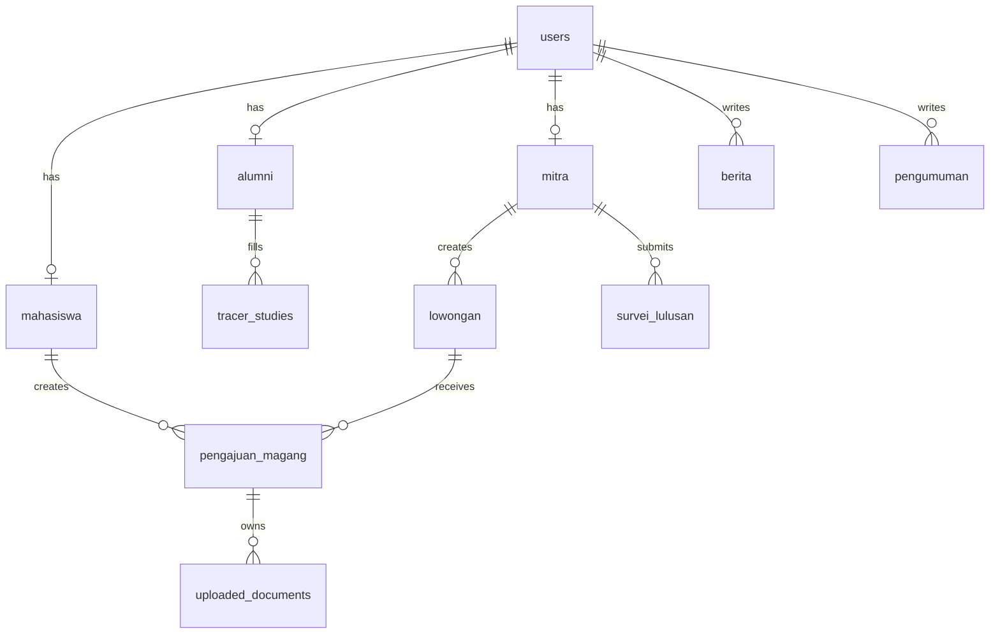
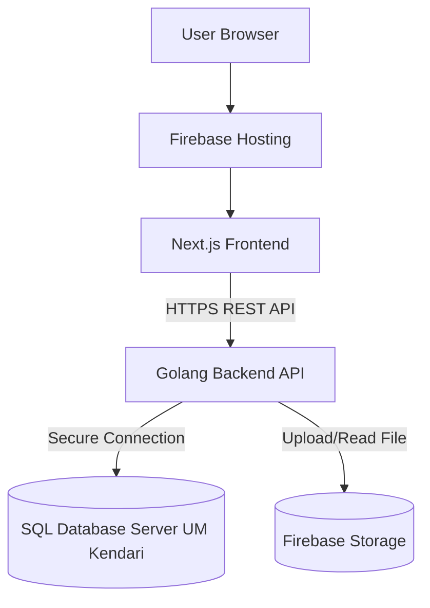
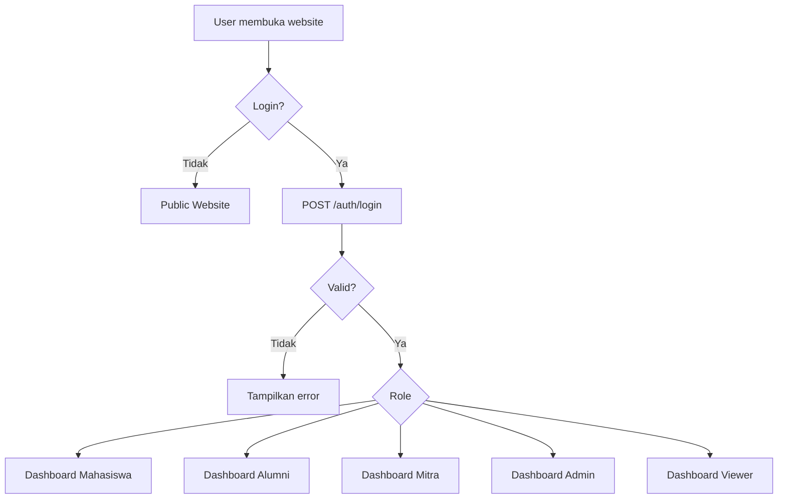
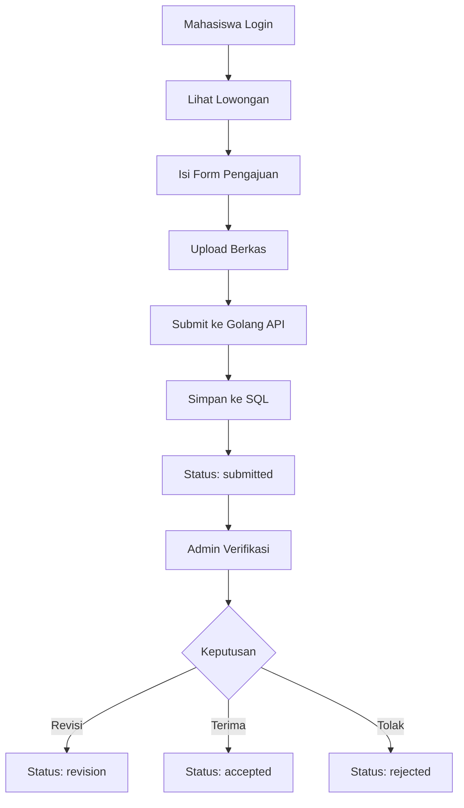
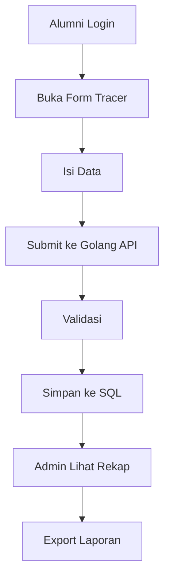

# PRD — Portal CDC UM Kendari

> **Product Requirements Document (PRD)**  
> **Produk:** Portal CDC, Magang, Alumni, Mitra, dan Tracer Study Universitas Muhammadiyah Kendari  
> **Penyusun:** Operator System  
> **Target:** Website responsive berbasis **Next.js + Golang Backend + SQL Database Server UM Kendari + Firebase Hosting**  
> **Versi:** MVP v1.1 — SQL + Golang Architecture  
> **Status:** Siap dijadikan acuan vibe coding / AI-assisted development

---

## 0. Perubahan Stack dari Versi Sebelumnya

PRD ini mengganti arsitektur yang sebelumnya memakai Firebase Database/Firestore menjadi arsitektur baru berikut:

| Komponen | Stack Final |
|---|---|
| Frontend | Next.js App Router + TypeScript |
| UI | Tailwind CSS + shadcn/ui |
| Backend | Golang REST API |
| Database | SQL Database pada Server Universitas Muhammadiyah Kendari |
| ORM/Query Layer | GORM atau SQLC, rekomendasi awal: GORM |
| Authentication | Custom JWT Auth dari Golang Backend |
| Password Hashing | bcrypt |
| File Storage | Firebase Storage untuk dokumen/gambar, metadata file tetap di SQL |
| Hosting Frontend | Firebase Hosting |
| Hosting Backend | Cloud Run via Firebase Hosting rewrite **atau** server backend kampus jika tersedia |
| API Communication | Next.js → Golang API → SQL Database Server Kampus |

> **Catatan penting:** Database SQL kampus **tidak boleh diakses langsung dari frontend Next.js**. Semua akses data wajib melewati Golang API agar credential database aman dan validasi tetap terkontrol.

---

## 1. Executive Summary

Portal CDC UM Kendari adalah website terpadu untuk membantu pengelolaan layanan **Career Development Center (CDC)**, informasi magang, lowongan kerja, data alumni, tracer study, mitra kerja sama, berita, pengumuman, dan laporan.

Website ini dirancang untuk menggantikan proses layanan yang masih tersebar menjadi satu portal yang lebih terstruktur. Pengguna utama sistem adalah:

- Pengunjung umum
- Mahasiswa
- Alumni
- Mitra kerja sama
- Admin CDC
- Pihak kampus / dosen / prodi sebagai viewer laporan

Fokus MVP adalah membangun sistem yang dapat digunakan untuk:

1. Menampilkan informasi CDC secara publik.
2. Menampilkan lowongan magang/kerja.
3. Login multi-role.
4. Mahasiswa mengajukan magang dan upload berkas.
5. Alumni mengisi tracer study.
6. Mitra membuat lowongan dan melihat pelamar.
7. Admin mengelola data utama dan laporan dasar.

---

## 2. Problem Statement

Saat ini layanan CDC, magang, alumni, tracer study, lowongan, dan mitra kerja sama membutuhkan sistem yang lebih terpusat. Jika data masih tersebar, maka beberapa masalah yang muncul adalah:

- Mahasiswa kesulitan mencari informasi magang dan status pengajuan.
- Alumni kurang praktis dalam mengisi tracer study.
- Admin CDC membutuhkan waktu lebih lama untuk mengelola data.
- Mitra belum memiliki kanal yang rapi untuk mempublikasikan lowongan.
- Pihak kampus sulit mendapatkan data rekap untuk evaluasi, laporan, dan akreditasi.

Solusi yang diusulkan adalah membangun **Portal CDC UM Kendari** sebagai website terpadu dengan fitur informasi, dashboard, manajemen data, tracer study, pengajuan magang, lowongan, dan laporan.

---

## 3. Product Goals

| Kode | Tujuan Produk | Prioritas |
|---|---|---|
| G-01 | Menyediakan portal CDC yang modern, informatif, dan mudah digunakan | Must |
| G-02 | Mengintegrasikan layanan magang, alumni, tracer study, mitra, lowongan, berita, dan laporan | Must |
| G-03 | Memudahkan mahasiswa mencari lowongan, mendaftar magang, upload berkas, dan cek status | Must |
| G-04 | Memudahkan alumni mengisi tracer study dan memperbarui data alumni | Must |
| G-05 | Memudahkan mitra membuka lowongan dan melihat data pelamar | Must |
| G-06 | Memudahkan admin CDC mengelola data dan mengekspor laporan | Must |
| G-07 | Menyediakan data pendukung untuk evaluasi, pelaporan, dan akreditasi kampus | Should |

---

## 4. Target Users & Personas

### 4.1 Pengunjung Umum

**Deskripsi:** Pengguna publik yang belum login.  
**Kebutuhan:** Melihat informasi CDC, profil, berita, pengumuman, lowongan umum, panduan, dan kontak.

### 4.2 Mahasiswa

**Deskripsi:** Mahasiswa aktif Universitas Muhammadiyah Kendari.  
**Kebutuhan:** Mencari lowongan magang, mendaftar magang, upload berkas, melihat status pengajuan, dan melihat riwayat pengajuan.

### 4.3 Alumni

**Deskripsi:** Lulusan Universitas Muhammadiyah Kendari.  
**Kebutuhan:** Mengisi tracer study, memperbarui data alumni, melihat informasi karier, dan melihat riwayat pengisian tracer study.

### 4.4 Mitra Kerja Sama

**Deskripsi:** Perusahaan atau instansi yang bekerja sama dengan CDC.  
**Kebutuhan:** Membuat lowongan magang/kerja, melihat data pelamar, dan mengisi survei pengguna lulusan.

### 4.5 Admin CDC

**Deskripsi:** Pengelola utama sistem.  
**Kebutuhan:** Mengelola data mahasiswa, alumni, mitra, lowongan, pengajuan magang, tracer study, berita, pengumuman, dan laporan.

### 4.6 Viewer Kampus / Dosen / Prodi

**Deskripsi:** Pihak internal kampus yang membutuhkan data pendukung.  
**Kebutuhan:** Melihat rekap data mahasiswa magang, alumni, hasil tracer study, lowongan, dan mitra untuk monitoring atau laporan.

---

## 5. MVP Scope

### 5.1 In Scope — Wajib Dibuat di MVP

| Modul | Fitur |
|---|---|
| Public Website | Beranda, Profil CDC, Informasi Magang, Lowongan, Berita, Pengumuman, Kontak |
| Authentication | Login multi-role berbasis JWT untuk mahasiswa, alumni, mitra, admin, dan viewer kampus |
| Dashboard Mahasiswa | Profil, daftar lowongan, form pendaftaran magang, upload berkas, status pengajuan, riwayat |
| Dashboard Alumni | Profil alumni, form tracer study, riwayat pengisian, informasi karier |
| Dashboard Mitra | Profil mitra, tambah lowongan, daftar lowongan, data pelamar |
| Dashboard Admin | Statistik ringkas, kelola data, validasi pengajuan, kelola konten, laporan |
| File Upload | Upload dokumen pendukung pengajuan magang |
| Laporan | Rekap data dasar dan export Excel/PDF |
| Role Access | Pembatasan akses berdasarkan role |
| API Backend | REST API Golang untuk seluruh transaksi data |
| SQL Database | Penyimpanan data utama di database server kampus |

### 5.2 Out of Scope — Tidak Wajib di MVP

| Fitur | Status |
|---|---|
| Logbook magang harian | Future |
| Penilaian dosen dan mitra | Future |
| Sertifikat digital otomatis | Future |
| Notifikasi WhatsApp otomatis | Future |
| SSO kampus | Future |
| Chat internal mahasiswa-admin | Future |
| Integrasi penuh ke sistem akademik kampus | Future |

---

## 6. Product Principles

1. **Simple first** — Fitur dibuat sederhana dulu, jangan langsung kompleks.
2. **Role-based** — Setiap pengguna hanya melihat fitur sesuai perannya.
3. **Data-centered** — Setiap form harus menghasilkan data yang bisa direkap.
4. **Admin-friendly** — Admin harus mudah mencari, memfilter, memvalidasi, dan mengekspor data.
5. **Mobile responsive** — Mahasiswa dan alumni kemungkinan besar mengakses lewat HP.
6. **Secure by design** — Database kampus tidak boleh terekspos langsung ke client.
7. **API-first** — Semua fitur data harus melewati REST API Golang.
8. **Scalable** — Struktur data, folder, dan endpoint dibuat rapi agar bisa dikembangkan lagi.

---

## 7. Recommended Tech Stack

| Layer | Teknologi | Catatan |
|---|---|---|
| Frontend | Next.js App Router | UI portal dan dashboard |
| Frontend Language | TypeScript | Supaya tipe data lebih aman |
| Styling | Tailwind CSS | Cepat, modern, konsisten |
| UI Component | shadcn/ui | Untuk dashboard, table, dialog, form |
| Form Validation Frontend | React Hook Form + Zod | Validasi input sebelum request API |
| Backend | Golang | REST API utama |
| Backend Router | Gin atau Fiber | Rekomendasi awal: Gin |
| ORM | GORM | Cocok untuk SQL dan cepat untuk MVP |
| Database | SQL Server Kampus UM Kendari | Rekomendasi implementasi: MySQL/MariaDB jika server kampus mendukung |
| Auth | JWT + bcrypt | Login custom dari backend Golang |
| File Storage | Firebase Storage | Untuk dokumen mahasiswa dan gambar konten |
| Hosting Frontend | Firebase Hosting | Deploy web Next.js |
| Backend Deployment | Cloud Run via Firebase Hosting rewrite atau server backend kampus | Pilih sesuai kebijakan kampus |
| Charts | Recharts | Statistik dashboard |
| Export | XLSX + jsPDF di frontend atau endpoint export dari Go | Export laporan |
| API Client | Axios atau fetch wrapper | Komunikasi Next.js ke Go API |

---

## 8. System Architecture

### 8.1 Arsitektur Utama

```txt
User Browser
   ↓
Firebase Hosting
   ↓
Next.js Frontend
   ↓ HTTPS API Request
Golang REST API
   ↓ Secure DB Connection
SQL Database Server Universitas Muhammadiyah Kendari
```

### 8.2 Arsitektur File Upload

```txt
User Browser
   ↓ pilih file
Next.js Frontend
   ↓ request upload token / upload endpoint
Golang API
   ↓ validasi user, role, tipe file
Firebase Storage
   ↓ return file URL/path
SQL Database
   ↓ simpan metadata file: owner_id, file_url, file_path, file_type, size
```

### 8.3 Catatan Keamanan Arsitektur

- Credential database SQL hanya disimpan di environment backend Golang.
- Next.js tidak menyimpan username/password database.
- Semua endpoint private wajib memakai JWT middleware.
- Semua endpoint admin wajib memakai role guard `admin`.
- Semua file upload wajib dibatasi format dan ukuran.
- Koneksi dari backend ke database kampus idealnya memakai allowlist IP, VPN, atau private network sesuai kebijakan server kampus.

---

## 9. Information Architecture

### 9.1 Public Routes

| Route | Halaman | Akses |
|---|---|---|
| `/` | Beranda | Public |
| `/profil-cdc` | Profil CDC | Public |
| `/informasi-magang` | Informasi Magang | Public |
| `/lowongan` | Daftar Lowongan | Public |
| `/lowongan/[id]` | Detail Lowongan | Public |
| `/tracer-study` | Informasi Tracer Study | Public |
| `/alumni` | Informasi Alumni | Public |
| `/mitra` | Informasi Mitra | Public |
| `/berita` | Daftar Berita | Public |
| `/berita/[slug]` | Detail Berita | Public |
| `/pengumuman` | Daftar Pengumuman | Public |
| `/kontak` | Kontak CDC | Public |
| `/login` | Login | Public |

### 9.2 Dashboard Mahasiswa Routes

| Route | Halaman | Akses |
|---|---|---|
| `/dashboard/mahasiswa` | Dashboard Mahasiswa | Mahasiswa |
| `/dashboard/mahasiswa/profil` | Profil Mahasiswa | Mahasiswa |
| `/dashboard/mahasiswa/lowongan` | Lowongan Magang | Mahasiswa |
| `/dashboard/mahasiswa/pengajuan` | Form Pengajuan Magang | Mahasiswa |
| `/dashboard/mahasiswa/berkas` | Upload Berkas | Mahasiswa |
| `/dashboard/mahasiswa/status` | Status Pengajuan | Mahasiswa |
| `/dashboard/mahasiswa/riwayat` | Riwayat Pengajuan | Mahasiswa |

### 9.3 Dashboard Alumni Routes

| Route | Halaman | Akses |
|---|---|---|
| `/dashboard/alumni` | Dashboard Alumni | Alumni |
| `/dashboard/alumni/profil` | Profil Alumni | Alumni |
| `/dashboard/alumni/tracer-study` | Form Tracer Study | Alumni |
| `/dashboard/alumni/riwayat-tracer` | Riwayat Tracer Study | Alumni |
| `/dashboard/alumni/lowongan` | Lowongan Kerja | Alumni |

### 9.4 Dashboard Mitra Routes

| Route | Halaman | Akses |
|---|---|---|
| `/dashboard/mitra` | Dashboard Mitra | Mitra |
| `/dashboard/mitra/profil` | Profil Mitra | Mitra |
| `/dashboard/mitra/lowongan` | Daftar Lowongan Mitra | Mitra |
| `/dashboard/mitra/lowongan/tambah` | Tambah Lowongan | Mitra |
| `/dashboard/mitra/pelamar` | Data Pelamar | Mitra |
| `/dashboard/mitra/survei-lulusan` | Survei Pengguna Lulusan | Mitra |

### 9.5 Dashboard Admin Routes

| Route | Halaman | Akses |
|---|---|---|
| `/dashboard/admin` | Dashboard Admin | Admin |
| `/dashboard/admin/mahasiswa` | Kelola Mahasiswa | Admin |
| `/dashboard/admin/alumni` | Kelola Alumni | Admin |
| `/dashboard/admin/mitra` | Kelola Mitra | Admin |
| `/dashboard/admin/lowongan` | Kelola Lowongan | Admin |
| `/dashboard/admin/pengajuan-magang` | Kelola Pengajuan Magang | Admin |
| `/dashboard/admin/tracer-study` | Kelola Tracer Study | Admin |
| `/dashboard/admin/berita` | Kelola Berita | Admin |
| `/dashboard/admin/pengumuman` | Kelola Pengumuman | Admin |
| `/dashboard/admin/laporan` | Kelola Laporan | Admin |
| `/dashboard/admin/pengaturan` | Pengaturan Website | Admin |

### 9.6 Viewer Kampus Routes

| Route | Halaman | Akses |
|---|---|---|
| `/dashboard/viewer` | Dashboard Viewer | Viewer |
| `/dashboard/viewer/laporan` | Laporan Ringkas | Viewer |
| `/dashboard/viewer/tracer-study` | Rekap Tracer Study | Viewer |
| `/dashboard/viewer/magang` | Rekap Magang | Viewer |

---

## 10. Functional Requirements

### 10.1 Authentication & Authorization

| Kode | Requirement | Prioritas | Acceptance Criteria |
|---|---|---|---|
| FR-AUTH-01 | Sistem menyediakan login email/password | Must | User dapat login memakai email dan password |
| FR-AUTH-02 | Password disimpan dalam bentuk hash bcrypt | Must | Tidak ada password plain text di database |
| FR-AUTH-03 | Backend mengembalikan access token JWT | Must | Token dipakai untuk request endpoint private |
| FR-AUTH-04 | Sistem membaca role user dari SQL database | Must | User diarahkan ke dashboard sesuai role |
| FR-AUTH-05 | Sistem menolak akun inactive/pending/rejected | Must | User mendapat pesan status akun |
| FR-AUTH-06 | Sistem menyediakan logout | Must | Token dihapus dari client |
| FR-AUTH-07 | Middleware backend memvalidasi JWT | Must | Endpoint private tidak dapat diakses tanpa token |
| FR-AUTH-08 | Middleware backend memvalidasi role | Must | Endpoint admin tidak dapat diakses user non-admin |

### 10.2 Public Website

| Kode | Requirement | Prioritas | Acceptance Criteria |
|---|---|---|---|
| FR-PUB-01 | Menampilkan halaman beranda CDC | Must | Beranda dapat diakses tanpa login |
| FR-PUB-02 | Menampilkan profil CDC | Must | Konten profil tampil dari database atau static content |
| FR-PUB-03 | Menampilkan informasi magang | Must | Panduan magang tampil rapi |
| FR-PUB-04 | Menampilkan daftar lowongan published | Must | Data diambil dari endpoint `/api/v1/public/lowongan` |
| FR-PUB-05 | Menampilkan detail lowongan | Must | Detail berdasarkan `id` lowongan |
| FR-PUB-06 | Menampilkan berita dan pengumuman | Must | Hanya konten status published yang tampil |
| FR-PUB-07 | Menampilkan kontak CDC | Must | Email/WA/alamat tampil jelas |

### 10.3 Modul Mahasiswa

| Kode | Requirement | Prioritas | Acceptance Criteria |
|---|---|---|---|
| FR-MHS-01 | Mahasiswa dapat melihat dashboard pribadi | Must | Data hanya milik user login |
| FR-MHS-02 | Mahasiswa dapat mengubah profil | Must | Data profil tersimpan ke SQL |
| FR-MHS-03 | Mahasiswa dapat melihat lowongan magang | Must | Lowongan status published tampil |
| FR-MHS-04 | Mahasiswa dapat submit pengajuan magang | Must | Data masuk tabel `pengajuan_magang` |
| FR-MHS-05 | Mahasiswa dapat upload berkas | Must | Metadata file masuk tabel `uploaded_documents` |
| FR-MHS-06 | Mahasiswa dapat melihat status pengajuan | Must | Status sesuai data admin |
| FR-MHS-07 | Mahasiswa dapat melihat riwayat pengajuan | Should | Riwayat tampil berdasarkan user login |

### 10.4 Modul Alumni

| Kode | Requirement | Prioritas | Acceptance Criteria |
|---|---|---|---|
| FR-ALM-01 | Alumni dapat melihat dashboard alumni | Must | Dashboard tampil setelah login |
| FR-ALM-02 | Alumni dapat memperbarui profil | Must | Data alumni tersimpan ke SQL |
| FR-ALM-03 | Alumni dapat mengisi tracer study | Must | Data masuk tabel `tracer_studies` |
| FR-ALM-04 | Alumni dapat melihat riwayat tracer study | Should | Riwayat tampil berdasarkan user login |
| FR-ALM-05 | Alumni dapat melihat informasi karier/lowongan | Should | Lowongan kerja published tampil |

### 10.5 Modul Mitra

| Kode | Requirement | Prioritas | Acceptance Criteria |
|---|---|---|---|
| FR-MTR-01 | Mitra dapat melihat dashboard mitra | Must | Dashboard tampil setelah login |
| FR-MTR-02 | Mitra dapat melengkapi profil instansi | Must | Profil tersimpan ke SQL |
| FR-MTR-03 | Mitra dapat membuat lowongan | Must | Lowongan masuk tabel `lowongan` |
| FR-MTR-04 | Mitra dapat mengubah dan menutup lowongan | Must | Status lowongan dapat berubah |
| FR-MTR-05 | Mitra dapat melihat daftar pelamar | Must | Hanya pelamar pada lowongan milik mitra |
| FR-MTR-06 | Mitra dapat mengisi survei pengguna lulusan | Should | Data masuk tabel `survei_lulusan` |

### 10.6 Modul Admin

| Kode | Requirement | Prioritas | Acceptance Criteria |
|---|---|---|---|
| FR-ADM-01 | Admin dapat melihat dashboard statistik | Must | Statistik mengambil data dari SQL |
| FR-ADM-02 | Admin dapat mengelola data mahasiswa | Must | CRUD mahasiswa tersedia |
| FR-ADM-03 | Admin dapat mengelola data alumni | Must | CRUD alumni tersedia |
| FR-ADM-04 | Admin dapat mengelola data mitra | Must | CRUD mitra tersedia |
| FR-ADM-05 | Admin dapat mengelola lowongan | Must | CRUD dan publish/close tersedia |
| FR-ADM-06 | Admin dapat memverifikasi pengajuan magang | Must | Status pengajuan dapat berubah |
| FR-ADM-07 | Admin dapat mengelola tracer study | Must | Data tracer dapat dilihat/filter/export |
| FR-ADM-08 | Admin dapat mengelola berita dan pengumuman | Must | CRUD konten tersedia |
| FR-ADM-09 | Admin dapat melihat dan mengekspor laporan | Must | Export Excel tersedia |
| FR-ADM-10 | Admin dapat mengatur konten website dasar | Should | Data pengaturan tersimpan |

---

## 11. Role Permission Matrix

| Fitur | Pengunjung | Mahasiswa | Alumni | Mitra | Admin | Viewer |
|---|---:|---:|---:|---:|---:|---:|
| Lihat beranda | ✅ | ✅ | ✅ | ✅ | ✅ | ✅ |
| Lihat lowongan publik | ✅ | ✅ | ✅ | ✅ | ✅ | ✅ |
| Login | ✅ | ✅ | ✅ | ✅ | ✅ | ✅ |
| Daftar magang | ❌ | ✅ | ❌ | ❌ | ✅ | ❌ |
| Upload berkas | ❌ | ✅ | ❌ | ❌ | ✅ | ❌ |
| Cek status magang | ❌ | ✅ | ❌ | ❌ | ✅ | ✅ |
| Isi tracer study | ❌ | ❌ | ✅ | ❌ | ✅ | ❌ |
| Buat lowongan | ❌ | ❌ | ❌ | ✅ | ✅ | ❌ |
| Lihat pelamar | ❌ | ❌ | ❌ | ✅ | ✅ | ❌ |
| Kelola berita | ❌ | ❌ | ❌ | ❌ | ✅ | ❌ |
| Kelola data user | ❌ | ❌ | ❌ | ❌ | ✅ | ❌ |
| Lihat laporan | ❌ | ❌ | ❌ | ❌ | ✅ | ✅ |
| Export laporan | ❌ | ❌ | ❌ | ❌ | ✅ | Should |

---

## 12. Status & Workflow

### 12.1 Status Pengajuan Magang

| Status Sistem | Label UI | Keterangan |
|---|---|---|
| `draft` | Draft | Belum dikirim |
| `submitted` | Dikirim | Mahasiswa mengirim pengajuan |
| `under_review` | Menunggu Verifikasi | Admin memeriksa data |
| `revision` | Revisi | Mahasiswa perlu memperbaiki data/berkas |
| `accepted` | Diterima | Pengajuan disetujui |
| `rejected` | Ditolak | Pengajuan tidak disetujui |
| `ongoing` | Berjalan | Mahasiswa sedang magang |
| `report_submitted` | Laporan Dikirim | Laporan akhir telah dikirim |
| `completed` | Selesai | Magang selesai dan diverifikasi |

### 12.2 Status Lowongan

| Status Sistem | Label UI | Keterangan |
|---|---|---|
| `draft` | Draft | Lowongan belum tampil publik |
| `published` | Dipublikasikan | Lowongan tampil publik |
| `closed` | Ditutup | Lowongan tidak menerima pelamar |
| `archived` | Diarsipkan | Lowongan disimpan sebagai arsip |

### 12.3 Status Akun

| Status Sistem | Label UI | Keterangan |
|---|---|---|
| `pending` | Menunggu Verifikasi | Akun belum aktif |
| `active` | Aktif | Akun dapat digunakan |
| `inactive` | Nonaktif | Akun dinonaktifkan |
| `rejected` | Ditolak | Registrasi/akun ditolak |

---

## 13. SQL Database Model

> Gunakan `snake_case` untuk nama tabel dan kolom. Semua tabel utama wajib punya `created_at` dan `updated_at`.  
> Tipe SQL di bawah memakai gaya MySQL/MariaDB. Jika server kampus memakai PostgreSQL, tipe data dapat disesuaikan.

### 13.1 ERD Ringkas



### 13.2 `users`

```sql
CREATE TABLE users (
  id BIGINT UNSIGNED PRIMARY KEY AUTO_INCREMENT,
  name VARCHAR(150) NOT NULL,
  email VARCHAR(150) NOT NULL UNIQUE,
  password_hash VARCHAR(255) NOT NULL,
  phone VARCHAR(30),
  role ENUM('mahasiswa','alumni','mitra','admin','viewer') NOT NULL,
  status ENUM('pending','active','inactive','rejected') NOT NULL DEFAULT 'pending',
  photo_url TEXT,
  last_login_at DATETIME NULL,
  created_at DATETIME NOT NULL DEFAULT CURRENT_TIMESTAMP,
  updated_at DATETIME NOT NULL DEFAULT CURRENT_TIMESTAMP ON UPDATE CURRENT_TIMESTAMP
);
```

### 13.3 `mahasiswa`

```sql
CREATE TABLE mahasiswa (
  id BIGINT UNSIGNED PRIMARY KEY AUTO_INCREMENT,
  user_id BIGINT UNSIGNED NOT NULL,
  nim VARCHAR(30) NOT NULL UNIQUE,
  nama VARCHAR(150) NOT NULL,
  email VARCHAR(150) NOT NULL,
  phone VARCHAR(30),
  program_studi VARCHAR(150) NOT NULL,
  fakultas VARCHAR(150) NOT NULL,
  angkatan YEAR,
  semester INT,
  alamat TEXT,
  created_at DATETIME NOT NULL DEFAULT CURRENT_TIMESTAMP,
  updated_at DATETIME NOT NULL DEFAULT CURRENT_TIMESTAMP ON UPDATE CURRENT_TIMESTAMP,
  CONSTRAINT fk_mahasiswa_user FOREIGN KEY (user_id) REFERENCES users(id) ON DELETE CASCADE
);
```

### 13.4 `alumni`

```sql
CREATE TABLE alumni (
  id BIGINT UNSIGNED PRIMARY KEY AUTO_INCREMENT,
  user_id BIGINT UNSIGNED NOT NULL,
  nim VARCHAR(30),
  nama VARCHAR(150) NOT NULL,
  email VARCHAR(150) NOT NULL,
  phone VARCHAR(30),
  program_studi VARCHAR(150) NOT NULL,
  fakultas VARCHAR(150) NOT NULL,
  tahun_lulus YEAR NOT NULL,
  status_pekerjaan ENUM('bekerja','wirausaha','lanjut_studi','belum_bekerja'),
  instansi_kerja VARCHAR(200),
  jabatan VARCHAR(150),
  created_at DATETIME NOT NULL DEFAULT CURRENT_TIMESTAMP,
  updated_at DATETIME NOT NULL DEFAULT CURRENT_TIMESTAMP ON UPDATE CURRENT_TIMESTAMP,
  CONSTRAINT fk_alumni_user FOREIGN KEY (user_id) REFERENCES users(id) ON DELETE CASCADE
);
```

### 13.5 `mitra`

```sql
CREATE TABLE mitra (
  id BIGINT UNSIGNED PRIMARY KEY AUTO_INCREMENT,
  user_id BIGINT UNSIGNED NOT NULL,
  nama_instansi VARCHAR(200) NOT NULL,
  bidang_industri VARCHAR(150),
  alamat TEXT,
  kontak_person VARCHAR(150) NOT NULL,
  email VARCHAR(150) NOT NULL,
  phone VARCHAR(30),
  website VARCHAR(255),
  status_kerja_sama ENUM('aktif','nonaktif','pending') NOT NULL DEFAULT 'pending',
  created_at DATETIME NOT NULL DEFAULT CURRENT_TIMESTAMP,
  updated_at DATETIME NOT NULL DEFAULT CURRENT_TIMESTAMP ON UPDATE CURRENT_TIMESTAMP,
  CONSTRAINT fk_mitra_user FOREIGN KEY (user_id) REFERENCES users(id) ON DELETE CASCADE
);
```

### 13.6 `lowongan`

```sql
CREATE TABLE lowongan (
  id BIGINT UNSIGNED PRIMARY KEY AUTO_INCREMENT,
  mitra_id BIGINT UNSIGNED NULL,
  created_by BIGINT UNSIGNED NOT NULL,
  judul VARCHAR(200) NOT NULL,
  tipe ENUM('magang','kerja') NOT NULL,
  nama_instansi VARCHAR(200) NOT NULL,
  lokasi VARCHAR(200) NOT NULL,
  deskripsi TEXT NOT NULL,
  kualifikasi JSON NULL,
  benefit JSON NULL,
  kuota INT NULL,
  deadline DATE NOT NULL,
  status ENUM('draft','published','closed','archived') NOT NULL DEFAULT 'draft',
  created_at DATETIME NOT NULL DEFAULT CURRENT_TIMESTAMP,
  updated_at DATETIME NOT NULL DEFAULT CURRENT_TIMESTAMP ON UPDATE CURRENT_TIMESTAMP,
  CONSTRAINT fk_lowongan_mitra FOREIGN KEY (mitra_id) REFERENCES mitra(id) ON DELETE SET NULL,
  CONSTRAINT fk_lowongan_creator FOREIGN KEY (created_by) REFERENCES users(id) ON DELETE RESTRICT
);
```

### 13.7 `pengajuan_magang`

```sql
CREATE TABLE pengajuan_magang (
  id BIGINT UNSIGNED PRIMARY KEY AUTO_INCREMENT,
  mahasiswa_id BIGINT UNSIGNED NOT NULL,
  user_id BIGINT UNSIGNED NOT NULL,
  lowongan_id BIGINT UNSIGNED NULL,
  nama_mahasiswa VARCHAR(150) NOT NULL,
  nim VARCHAR(30) NOT NULL,
  program_studi VARCHAR(150) NOT NULL,
  tujuan_magang VARCHAR(200) NOT NULL,
  lokasi_magang VARCHAR(200),
  tanggal_mulai DATE,
  tanggal_selesai DATE,
  status ENUM('draft','submitted','under_review','revision','accepted','rejected','ongoing','report_submitted','completed') NOT NULL DEFAULT 'submitted',
  catatan_admin TEXT,
  verified_by BIGINT UNSIGNED NULL,
  verified_at DATETIME NULL,
  created_at DATETIME NOT NULL DEFAULT CURRENT_TIMESTAMP,
  updated_at DATETIME NOT NULL DEFAULT CURRENT_TIMESTAMP ON UPDATE CURRENT_TIMESTAMP,
  CONSTRAINT fk_pengajuan_mahasiswa FOREIGN KEY (mahasiswa_id) REFERENCES mahasiswa(id) ON DELETE CASCADE,
  CONSTRAINT fk_pengajuan_user FOREIGN KEY (user_id) REFERENCES users(id) ON DELETE CASCADE,
  CONSTRAINT fk_pengajuan_lowongan FOREIGN KEY (lowongan_id) REFERENCES lowongan(id) ON DELETE SET NULL,
  CONSTRAINT fk_pengajuan_verifier FOREIGN KEY (verified_by) REFERENCES users(id) ON DELETE SET NULL
);
```

### 13.8 `uploaded_documents`

```sql
CREATE TABLE uploaded_documents (
  id BIGINT UNSIGNED PRIMARY KEY AUTO_INCREMENT,
  owner_user_id BIGINT UNSIGNED NOT NULL,
  pengajuan_id BIGINT UNSIGNED NULL,
  name VARCHAR(200) NOT NULL,
  type ENUM('surat_pengantar','cv','transkrip','proposal','laporan','cover_berita','avatar','lainnya') NOT NULL,
  file_url TEXT NOT NULL,
  file_path TEXT NOT NULL,
  mime_type VARCHAR(100) NOT NULL,
  size_bytes BIGINT UNSIGNED NOT NULL,
  uploaded_at DATETIME NOT NULL DEFAULT CURRENT_TIMESTAMP,
  created_at DATETIME NOT NULL DEFAULT CURRENT_TIMESTAMP,
  updated_at DATETIME NOT NULL DEFAULT CURRENT_TIMESTAMP ON UPDATE CURRENT_TIMESTAMP,
  CONSTRAINT fk_document_owner FOREIGN KEY (owner_user_id) REFERENCES users(id) ON DELETE CASCADE,
  CONSTRAINT fk_document_pengajuan FOREIGN KEY (pengajuan_id) REFERENCES pengajuan_magang(id) ON DELETE CASCADE
);
```

### 13.9 `tracer_studies`

```sql
CREATE TABLE tracer_studies (
  id BIGINT UNSIGNED PRIMARY KEY AUTO_INCREMENT,
  alumni_id BIGINT UNSIGNED NOT NULL,
  user_id BIGINT UNSIGNED NOT NULL,
  nama VARCHAR(150) NOT NULL,
  program_studi VARCHAR(150) NOT NULL,
  tahun_lulus YEAR NOT NULL,
  status_pekerjaan ENUM('bekerja','wirausaha','lanjut_studi','belum_bekerja') NOT NULL,
  masa_tunggu_kerja ENUM('kurang_3_bulan','3_6_bulan','6_12_bulan','lebih_12_bulan'),
  nama_instansi VARCHAR(200),
  jabatan VARCHAR(150),
  bidang_pekerjaan VARCHAR(150),
  kesesuaian_bidang ENUM('sangat_sesuai','sesuai','kurang_sesuai','tidak_sesuai'),
  range_penghasilan ENUM('kurang_2jt','2_5jt','5_10jt','lebih_10jt'),
  saran_untuk_kampus TEXT,
  submitted_at DATETIME NOT NULL DEFAULT CURRENT_TIMESTAMP,
  created_at DATETIME NOT NULL DEFAULT CURRENT_TIMESTAMP,
  updated_at DATETIME NOT NULL DEFAULT CURRENT_TIMESTAMP ON UPDATE CURRENT_TIMESTAMP,
  CONSTRAINT fk_tracer_alumni FOREIGN KEY (alumni_id) REFERENCES alumni(id) ON DELETE CASCADE,
  CONSTRAINT fk_tracer_user FOREIGN KEY (user_id) REFERENCES users(id) ON DELETE CASCADE
);
```

### 13.10 `berita`

```sql
CREATE TABLE berita (
  id BIGINT UNSIGNED PRIMARY KEY AUTO_INCREMENT,
  title VARCHAR(200) NOT NULL,
  slug VARCHAR(220) NOT NULL UNIQUE,
  excerpt TEXT NOT NULL,
  content LONGTEXT NOT NULL,
  cover_image_url TEXT,
  status ENUM('draft','published') NOT NULL DEFAULT 'draft',
  author_id BIGINT UNSIGNED NOT NULL,
  published_at DATETIME NULL,
  created_at DATETIME NOT NULL DEFAULT CURRENT_TIMESTAMP,
  updated_at DATETIME NOT NULL DEFAULT CURRENT_TIMESTAMP ON UPDATE CURRENT_TIMESTAMP,
  CONSTRAINT fk_berita_author FOREIGN KEY (author_id) REFERENCES users(id) ON DELETE RESTRICT
);
```

### 13.11 `pengumuman`

```sql
CREATE TABLE pengumuman (
  id BIGINT UNSIGNED PRIMARY KEY AUTO_INCREMENT,
  title VARCHAR(200) NOT NULL,
  content LONGTEXT NOT NULL,
  category ENUM('magang','tracer_study','lowongan','umum') DEFAULT 'umum',
  status ENUM('draft','published') NOT NULL DEFAULT 'draft',
  published_at DATETIME NULL,
  created_at DATETIME NOT NULL DEFAULT CURRENT_TIMESTAMP,
  updated_at DATETIME NOT NULL DEFAULT CURRENT_TIMESTAMP ON UPDATE CURRENT_TIMESTAMP
);
```

### 13.12 `survei_lulusan`

```sql
CREATE TABLE survei_lulusan (
  id BIGINT UNSIGNED PRIMARY KEY AUTO_INCREMENT,
  mitra_id BIGINT UNSIGNED NOT NULL,
  nama_instansi VARCHAR(200) NOT NULL,
  alumni_id BIGINT UNSIGNED NULL,
  kualitas_lulusan TINYINT UNSIGNED NOT NULL,
  kemampuan_teknis TINYINT UNSIGNED NOT NULL,
  kemampuan_komunikasi TINYINT UNSIGNED NOT NULL,
  etika_kerja TINYINT UNSIGNED NOT NULL,
  kemampuan_kerja_tim TINYINT UNSIGNED NOT NULL,
  saran TEXT,
  submitted_at DATETIME NOT NULL DEFAULT CURRENT_TIMESTAMP,
  created_at DATETIME NOT NULL DEFAULT CURRENT_TIMESTAMP,
  updated_at DATETIME NOT NULL DEFAULT CURRENT_TIMESTAMP ON UPDATE CURRENT_TIMESTAMP,
  CONSTRAINT fk_survei_mitra FOREIGN KEY (mitra_id) REFERENCES mitra(id) ON DELETE CASCADE,
  CONSTRAINT fk_survei_alumni FOREIGN KEY (alumni_id) REFERENCES alumni(id) ON DELETE SET NULL
);
```

---

## 14. REST API Specification — Golang Backend

Base URL:

```txt
/api/v1
```

### 14.1 Auth Endpoints

| Method | Endpoint | Role | Fungsi |
|---|---|---|---|
| POST | `/auth/login` | Public | Login dan mendapatkan JWT |
| POST | `/auth/logout` | Authenticated | Logout client-side/token invalidation optional |
| GET | `/auth/me` | Authenticated | Ambil data user login |
| POST | `/auth/change-password` | Authenticated | Ganti password |

Request login:

```json
{
  "email": "admin@umkendari.ac.id",
  "password": "password123"
}
```

Response login:

```json
{
  "token": "jwt_token_here",
  "user": {
    "id": 1,
    "name": "Admin CDC",
    "email": "admin@umkendari.ac.id",
    "role": "admin",
    "status": "active"
  }
}
```

### 14.2 Public Endpoints

| Method | Endpoint | Fungsi |
|---|---|---|
| GET | `/public/lowongan` | List lowongan published |
| GET | `/public/lowongan/:id` | Detail lowongan |
| GET | `/public/berita` | List berita published |
| GET | `/public/berita/:slug` | Detail berita |
| GET | `/public/pengumuman` | List pengumuman published |
| GET | `/public/statistics` | Statistik ringkas beranda |

### 14.3 Mahasiswa Endpoints

| Method | Endpoint | Fungsi |
|---|---|---|
| GET | `/mahasiswa/profile` | Ambil profil mahasiswa login |
| PUT | `/mahasiswa/profile` | Update profil mahasiswa |
| POST | `/mahasiswa/pengajuan` | Submit pengajuan magang |
| GET | `/mahasiswa/pengajuan` | Riwayat pengajuan mahasiswa |
| GET | `/mahasiswa/pengajuan/:id` | Detail pengajuan |
| POST | `/mahasiswa/pengajuan/:id/upload` | Upload dokumen pengajuan |

### 14.4 Alumni Endpoints

| Method | Endpoint | Fungsi |
|---|---|---|
| GET | `/alumni/profile` | Ambil profil alumni login |
| PUT | `/alumni/profile` | Update profil alumni |
| POST | `/alumni/tracer-study` | Submit tracer study |
| GET | `/alumni/tracer-study` | Riwayat tracer study alumni |

### 14.5 Mitra Endpoints

| Method | Endpoint | Fungsi |
|---|---|---|
| GET | `/mitra/profile` | Ambil profil mitra login |
| PUT | `/mitra/profile` | Update profil mitra |
| POST | `/mitra/lowongan` | Buat lowongan |
| GET | `/mitra/lowongan` | List lowongan milik mitra |
| PUT | `/mitra/lowongan/:id` | Edit lowongan |
| PATCH | `/mitra/lowongan/:id/status` | Publish/close lowongan |
| GET | `/mitra/lowongan/:id/pelamar` | Lihat pelamar |
| POST | `/mitra/survei-lulusan` | Isi survei pengguna lulusan |

### 14.6 Admin Endpoints

| Method | Endpoint | Fungsi |
|---|---|---|
| GET | `/admin/statistics` | Statistik dashboard admin |
| GET | `/admin/users` | Kelola users |
| POST | `/admin/users` | Tambah user |
| PUT | `/admin/users/:id` | Update user |
| PATCH | `/admin/users/:id/status` | Ubah status user |
| GET | `/admin/mahasiswa` | List mahasiswa |
| GET | `/admin/alumni` | List alumni |
| GET | `/admin/mitra` | List mitra |
| GET | `/admin/lowongan` | List semua lowongan |
| POST | `/admin/lowongan` | Admin tambah lowongan |
| GET | `/admin/pengajuan-magang` | List pengajuan magang |
| PATCH | `/admin/pengajuan-magang/:id/status` | Verifikasi/status pengajuan |
| GET | `/admin/tracer-study` | List tracer study |
| GET | `/admin/berita` | List berita admin |
| POST | `/admin/berita` | Tambah berita |
| PUT | `/admin/berita/:id` | Edit berita |
| DELETE | `/admin/berita/:id` | Hapus berita |
| GET | `/admin/pengumuman` | List pengumuman admin |
| POST | `/admin/pengumuman` | Tambah pengumuman |
| PUT | `/admin/pengumuman/:id` | Edit pengumuman |
| DELETE | `/admin/pengumuman/:id` | Hapus pengumuman |
| GET | `/admin/laporan/magang/export` | Export laporan magang |
| GET | `/admin/laporan/tracer/export` | Export laporan tracer |

---

## 15. Storage Structure

Gunakan Firebase Storage atau storage object yang disetujui kampus. Metadata file tetap masuk SQL.

```txt
/storage
  /pengajuan-magang
    /{userId}
      /{pengajuanId}
        surat_pengantar.pdf
        cv.pdf
        transkrip.pdf
        proposal.pdf
  /berita
    /{beritaId}
      cover.jpg
  /profile
    /{userId}
      avatar.jpg
```

Batasan file MVP:

| Jenis File | Format | Maksimal Ukuran |
|---|---|---|
| Dokumen magang | PDF, DOC, DOCX | 5 MB |
| Gambar profil | JPG, PNG, WEBP | 2 MB |
| Cover berita | JPG, PNG, WEBP | 3 MB |

---

## 16. Page Requirements

### 16.1 Beranda `/`

Komponen wajib:

- Navbar
- Hero section
- CTA: `Lihat Lowongan`, `Isi Tracer Study`, `Login Portal`
- Ringkasan layanan CDC
- Statistik singkat
- Lowongan terbaru
- Mitra kerja sama
- Berita/pengumuman terbaru
- Footer

Acceptance criteria:

- Halaman dapat diakses tanpa login.
- Tombol CTA menuju halaman yang benar.
- Lowongan terbaru mengambil data dari endpoint public dengan status `published`.
- Tampilan responsive di mobile.

### 16.2 Login `/login`

Komponen wajib:

- Input email
- Input password
- Tombol login
- Link lupa password optional
- Pesan error

Acceptance criteria:

- Jika login valid, backend mengembalikan JWT dan data user.
- Jika email/password salah, tampil pesan error.
- Jika role tidak aktif, tampil pesan bahwa akun belum aktif.
- Setelah login, user diarahkan ke dashboard sesuai role.

### 16.3 Dashboard Mahasiswa

Komponen wajib:

- Greeting card
- Status pengajuan terakhir
- Shortcut daftar magang
- Shortcut upload berkas
- Lowongan terbaru
- Riwayat pengajuan

Acceptance criteria:

- Data hanya milik mahasiswa yang login.
- Mahasiswa tidak bisa melihat data mahasiswa lain.

### 16.4 Form Pengajuan Magang

Field wajib:

- Nama mahasiswa
- NIM
- Program studi
- Lowongan/tujuan magang
- Alasan memilih tempat magang
- Tanggal rencana mulai
- Tanggal rencana selesai
- Upload dokumen wajib

Acceptance criteria:

- Submit gagal jika field wajib kosong.
- Submit gagal jika file tidak sesuai format.
- Jika sukses, data masuk ke SQL melalui Golang API.
- Status awal menjadi `submitted`.

### 16.5 Dashboard Alumni

Komponen wajib:

- Greeting card
- Status pengisian tracer study
- Shortcut isi tracer study
- Informasi karier
- Riwayat tracer study

Acceptance criteria:

- Data hanya milik alumni yang login.
- Alumni tidak dapat melihat data alumni lain.

### 16.6 Form Tracer Study

Field wajib:

- Nama
- Program studi
- Tahun lulus
- Status pekerjaan
- Masa tunggu kerja jika bekerja/wirausaha
- Instansi/jabatan jika bekerja
- Kesesuaian bidang
- Saran untuk kampus

Acceptance criteria:

- Submit gagal jika field wajib kosong.
- Data masuk tabel `tracer_studies`.
- Admin dapat melihat data tracer.

### 16.7 Dashboard Mitra

Komponen wajib:

- Profil mitra
- Daftar lowongan milik mitra
- Tombol tambah lowongan
- Data pelamar
- Survei pengguna lulusan

Acceptance criteria:

- Mitra hanya melihat lowongan miliknya.
- Mitra tidak bisa mengedit lowongan milik mitra lain.

### 16.8 Dashboard Admin

Komponen wajib:

- Statistik total mahasiswa, alumni, mitra, lowongan, pengajuan magang, tracer study
- Tabel data utama
- Filter dan search
- Aksi verifikasi
- Export laporan

Acceptance criteria:

- Hanya role admin yang bisa mengakses.
- Admin dapat mengubah status pengajuan.
- Admin dapat export laporan Excel.

---

## 17. Suggested Repository Structure

Gunakan struktur monorepo agar frontend dan backend rapi.

```txt
portal-cdc-umkendari/
  README.md
  .env.example
  firebase.json
  docs/
    PRD_Portal_CDC_UM_Kendari.md
    api-contract.md
    database-schema.sql
  apps/
    web/                         # Next.js Frontend
      package.json
      next.config.ts
      src/
        app/
          page.tsx
          profil-cdc/page.tsx
          informasi-magang/page.tsx
          lowongan/page.tsx
          lowongan/[id]/page.tsx
          tracer-study/page.tsx
          alumni/page.tsx
          mitra/page.tsx
          berita/page.tsx
          berita/[slug]/page.tsx
          pengumuman/page.tsx
          kontak/page.tsx
          login/page.tsx
          dashboard/
            mahasiswa/page.tsx
            alumni/page.tsx
            mitra/page.tsx
            admin/page.tsx
            viewer/page.tsx
        components/
          public/
          dashboard/
          forms/
          ui/
        lib/
          api/
            client.ts
            authApi.ts
            mahasiswaApi.ts
            alumniApi.ts
            mitraApi.ts
            lowonganApi.ts
            pengajuanApi.ts
            tracerApi.ts
            laporanApi.ts
          constants/
            routes.ts
            roles.ts
            statuses.ts
          validations/
            authSchema.ts
            pengajuanMagangSchema.ts
            tracerStudySchema.ts
            lowonganSchema.ts
          utils/
            formatDate.ts
            exportExcel.ts
        types/
          user.ts
          mahasiswa.ts
          alumni.ts
          mitra.ts
          lowongan.ts
          pengajuanMagang.ts
          tracerStudy.ts
          content.ts
    api/                         # Golang Backend
      go.mod
      go.sum
      cmd/
        server/
          main.go
      internal/
        config/
          config.go
        database/
          db.go
          migrations/
        middleware/
          auth_middleware.go
          role_middleware.go
          cors_middleware.go
        models/
          user.go
          mahasiswa.go
          alumni.go
          mitra.go
          lowongan.go
          pengajuan_magang.go
          uploaded_document.go
          tracer_study.go
          berita.go
          pengumuman.go
          survei_lulusan.go
        handlers/
          auth_handler.go
          public_handler.go
          mahasiswa_handler.go
          alumni_handler.go
          mitra_handler.go
          admin_handler.go
          upload_handler.go
          laporan_handler.go
        services/
          auth_service.go
          user_service.go
          mahasiswa_service.go
          alumni_service.go
          mitra_service.go
          lowongan_service.go
          pengajuan_service.go
          tracer_service.go
          laporan_service.go
          upload_service.go
        repositories/
          user_repository.go
          mahasiswa_repository.go
          alumni_repository.go
          mitra_repository.go
          lowongan_repository.go
          pengajuan_repository.go
          tracer_repository.go
          content_repository.go
        routes/
          routes.go
        utils/
          jwt.go
          password.go
          response.go
          validator.go
  scripts/
    seed.sql
    migrate.sh
```

---

## 18. Environment Variables

### 18.1 Frontend `.env.local`

```env
NEXT_PUBLIC_APP_NAME="Portal CDC UM Kendari"
NEXT_PUBLIC_API_BASE_URL="https://api-domain-kamu.com/api/v1"
NEXT_PUBLIC_FIREBASE_API_KEY=""
NEXT_PUBLIC_FIREBASE_AUTH_DOMAIN=""
NEXT_PUBLIC_FIREBASE_PROJECT_ID=""
NEXT_PUBLIC_FIREBASE_STORAGE_BUCKET=""
NEXT_PUBLIC_FIREBASE_MESSAGING_SENDER_ID=""
NEXT_PUBLIC_FIREBASE_APP_ID=""
```

### 18.2 Backend `.env`

```env
APP_ENV=development
APP_PORT=8080
APP_URL=http://localhost:8080
FRONTEND_URL=http://localhost:3000

DB_DRIVER=mysql
DB_HOST=server-db.umkendari.ac.id
DB_PORT=3306
DB_NAME=portal_cdc
DB_USER=portal_cdc_user
DB_PASSWORD=change_this_password

JWT_SECRET=change_this_secret
JWT_EXPIRES_IN_HOURS=24

FIREBASE_PROJECT_ID=
FIREBASE_STORAGE_BUCKET=
FIREBASE_SERVICE_ACCOUNT_PATH=./service-account.json
```

---

## 19. Validation Rules

### 19.1 Login

- Email wajib valid.
- Password wajib minimal 8 karakter.
- User harus status `active`.

### 19.2 Pengajuan Magang

- Nama, NIM, program studi wajib.
- Tanggal mulai tidak boleh setelah tanggal selesai.
- File wajib sesuai format.
- Maksimal ukuran file 5 MB.

### 19.3 Tracer Study

- Tahun lulus wajib.
- Status pekerjaan wajib.
- Jika status pekerjaan `bekerja`, nama instansi dan jabatan wajib.
- Jika status pekerjaan `belum_bekerja`, saran atau keterangan boleh optional.

### 19.4 Lowongan

- Judul wajib.
- Tipe wajib: `magang` atau `kerja`.
- Nama instansi wajib.
- Deadline tidak boleh tanggal lampau.
- Status publish hanya bisa jika data lowongan lengkap.

---

## 20. Reporting Requirements

### 20.1 Laporan MVP

| Laporan | Filter | Export |
|---|---|---|
| Laporan mahasiswa magang | Program studi, status, tanggal | Excel |
| Laporan alumni | Tahun lulus, prodi, status pekerjaan | Excel |
| Laporan tracer study | Tahun lulus, prodi, status pekerjaan | Excel/PDF |
| Laporan mitra | Status kerja sama, bidang industri | Excel |
| Laporan lowongan | Tipe, status, mitra | Excel |

### 20.2 Dashboard Statistics

Statistik minimal:

- Total mahasiswa terdaftar
- Total alumni terdaftar
- Total mitra aktif
- Total lowongan aktif
- Total pengajuan magang
- Total tracer study masuk
- Persentase alumni bekerja
- Jumlah pengajuan berdasarkan status

---

## 21. Non-Functional Requirements

| Kode | Requirement |
|---|---|
| NFR-01 | Website responsive di desktop, tablet, dan mobile |
| NFR-02 | Halaman utama idealnya dimuat kurang dari 3 detik pada koneksi stabil |
| NFR-03 | Semua endpoint private wajib memakai JWT middleware |
| NFR-04 | Role access wajib divalidasi di frontend dan backend |
| NFR-05 | Password wajib di-hash menggunakan bcrypt |
| NFR-06 | Database credential hanya berada di backend environment |
| NFR-07 | SQL query harus aman dari injection melalui ORM/prepared statement |
| NFR-08 | File upload harus membatasi tipe file dan ukuran |
| NFR-09 | Sistem memiliki loading, error, dan empty state |
| NFR-10 | Admin dapat melakukan pencarian dan filter data |
| NFR-11 | Backup database mengikuti kebijakan server kampus |
| NFR-12 | Semua tabel utama memiliki `created_at` dan `updated_at` |
| NFR-13 | API response memakai format JSON konsisten |
| NFR-14 | CORS hanya mengizinkan domain frontend resmi |

---

## 22. API Response Standard

### Success Response

```json
{
  "success": true,
  "message": "Data berhasil diambil",
  "data": {}
}
```

### Error Response

```json
{
  "success": false,
  "message": "Validasi gagal",
  "errors": {
    "email": "Email wajib diisi"
  }
}
```

### Pagination Response

```json
{
  "success": true,
  "message": "Data berhasil diambil",
  "data": [],
  "meta": {
    "page": 1,
    "limit": 10,
    "total": 100,
    "total_pages": 10
  }
}
```

---

## 23. UI/UX Guidelines

### 23.1 Visual Style

- Modern, clean, dan akademik.
- Warna utama mengikuti identitas UM Kendari/CDC.
- Gunakan whitespace cukup agar dashboard tidak terasa penuh.
- Gunakan table yang mudah dibaca untuk admin.

### 23.2 Layout

- Public website memakai navbar + footer.
- Dashboard memakai sidebar + topbar.
- Mobile dashboard memakai collapsible sidebar.
- Tombol aksi utama harus jelas.

### 23.3 Empty State Example

```txt
Belum ada pengajuan magang.
Silakan pilih lowongan dan kirim pengajuan magang terlebih dahulu.
[Tombol: Ajukan Magang]
```

---

## 24. Acceptance Criteria — Core Flows

### 24.1 Login Multi-Role

- User membuka `/login`.
- User memasukkan email dan password.
- Next.js mengirim request ke `POST /api/v1/auth/login`.
- Go API memvalidasi password hash dari SQL.
- Go API mengembalikan JWT dan user role.
- Frontend menyimpan token secara aman.
- User diarahkan ke dashboard sesuai role.

### 24.2 Pengajuan Magang Mahasiswa

- Mahasiswa login.
- Mahasiswa memilih lowongan atau mengisi tujuan magang manual.
- Mahasiswa mengisi form pengajuan.
- Mahasiswa upload dokumen wajib.
- Backend memvalidasi input dan role mahasiswa.
- Data masuk tabel `pengajuan_magang`.
- Metadata dokumen masuk tabel `uploaded_documents`.
- Status pengajuan tampil di dashboard mahasiswa.

### 24.3 Tracer Study Alumni

- Alumni login.
- Alumni membuka form tracer study.
- Alumni mengisi data pekerjaan/studi/wirausaha.
- Backend memvalidasi input dan role alumni.
- Data masuk tabel `tracer_studies`.
- Admin dapat melihat rekap data.

### 24.4 Lowongan Mitra

- Mitra login.
- Mitra membuat lowongan.
- Lowongan tersimpan sebagai `draft`.
- Mitra atau admin publish lowongan.
- Lowongan tampil di halaman publik jika status `published`.

### 24.5 Laporan Admin

- Admin login.
- Admin membuka menu laporan.
- Admin memilih jenis laporan dan filter.
- Backend mengambil data dari SQL.
- Sistem menampilkan preview data.
- Admin dapat export Excel.

---

## 25. Mermaid Diagrams

### 25.1 Architecture Diagram



### 25.2 User Role Flow



### 25.3 Pengajuan Magang



### 25.4 Tracer Study Alumni



---

## 26. Development Milestones

### Phase 1 — Project Setup

Checklist:

- [ ] Setup monorepo `apps/web` dan `apps/api`
- [ ] Setup Next.js + TypeScript
- [ ] Setup Tailwind CSS
- [ ] Setup shadcn/ui
- [ ] Setup Golang project
- [ ] Setup Gin/Fiber router
- [ ] Setup `.env.example` frontend/backend
- [ ] Setup constants roles/routes/statuses
- [ ] Setup basic layout public and dashboard

Output:

- Project frontend dan backend bisa dijalankan lokal.
- Halaman beranda dan login dummy tersedia.
- Endpoint health check backend tersedia.

### Phase 2 — SQL Database & Backend Foundation

Checklist:

- [ ] Buat schema SQL awal
- [ ] Setup koneksi database Golang
- [ ] Setup GORM models
- [ ] Setup migration/auto-migrate untuk development
- [ ] Setup repository pattern
- [ ] Setup response helper
- [ ] Setup error handler

Output:

- Backend terhubung ke SQL database.
- Model utama tersedia.
- Endpoint `/health` dan `/api/v1/public/statistics` dummy tersedia.

### Phase 3 — Authentication & Role Guard

Checklist:

- [ ] Login email/password
- [ ] bcrypt password verification
- [ ] JWT generation
- [ ] Auth middleware
- [ ] Role middleware
- [ ] Endpoint `/auth/me`
- [ ] Frontend auth store/session handling
- [ ] Protected route frontend
- [ ] Dashboard redirect berdasarkan role

Output:

- User bisa login dan masuk dashboard sesuai role.

### Phase 4 — Public Website

Checklist:

- [ ] Beranda
- [ ] Profil CDC
- [ ] Informasi Magang
- [ ] Lowongan publik dari API
- [ ] Detail lowongan dari API
- [ ] Berita dari API
- [ ] Pengumuman dari API
- [ ] Kontak

Output:

- Website publik sudah bisa ditunjukkan ke stakeholder.

### Phase 5 — Mahasiswa & Pengajuan Magang

Checklist:

- [ ] Profil mahasiswa
- [ ] List lowongan di dashboard
- [ ] Form pengajuan magang
- [ ] Upload berkas
- [ ] Status pengajuan
- [ ] Riwayat pengajuan
- [ ] Admin dapat melihat data pengajuan

Output:

- Mahasiswa bisa mengirim pengajuan magang.

### Phase 6 — Alumni & Tracer Study

Checklist:

- [ ] Profil alumni
- [ ] Form tracer study
- [ ] Riwayat tracer study
- [ ] Data masuk admin
- [ ] Filter tracer study admin

Output:

- Alumni bisa mengisi tracer study.

### Phase 7 — Mitra & Lowongan

Checklist:

- [ ] Profil mitra
- [ ] Tambah lowongan
- [ ] Edit lowongan
- [ ] Publish/close lowongan
- [ ] Lihat pelamar

Output:

- Mitra bisa mengelola lowongan.

### Phase 8 — Admin & Laporan

Checklist:

- [ ] Dashboard statistik admin
- [ ] Kelola mahasiswa
- [ ] Kelola alumni
- [ ] Kelola mitra
- [ ] Kelola lowongan
- [ ] Kelola pengajuan magang
- [ ] Kelola tracer study
- [ ] Kelola berita
- [ ] Kelola pengumuman
- [ ] Export laporan

Output:

- Admin bisa mengelola data utama dan laporan.

### Phase 9 — Deploy & QA

Checklist:

- [ ] Deploy Next.js ke Firebase Hosting
- [ ] Deploy Go backend ke Cloud Run atau server backend kampus
- [ ] Set environment production
- [ ] Set CORS domain production
- [ ] Test koneksi backend ke SQL server kampus
- [ ] Responsive check
- [ ] Role access test
- [ ] Upload file test
- [ ] Export laporan test
- [ ] Build/lint/typecheck

Output:

- MVP siap demo.

---

## 27. Definition of Done

Sebuah fitur dianggap selesai jika:

- [ ] UI sesuai kebutuhan halaman.
- [ ] Form memiliki validasi frontend dan backend.
- [ ] Data tersimpan ke SQL melalui Golang API.
- [ ] Endpoint memiliki auth/role guard jika private.
- [ ] Loading state tersedia.
- [ ] Error state tersedia.
- [ ] Empty state tersedia jika data kosong.
- [ ] Role access sesuai permission.
- [ ] Responsive di mobile dan desktop.
- [ ] Tidak ada error TypeScript.
- [ ] Tidak ada error build frontend.
- [ ] Tidak ada error compile backend Go.
- [ ] API response konsisten.

---

## 28. Success Metrics

| Metrik | Target MVP |
|---|---|
| Mahasiswa berhasil submit pengajuan magang | Minimal 80% tanpa bantuan admin |
| Alumni berhasil submit tracer study | Minimal 70% dari alumni yang login |
| Admin dapat export laporan | Maksimal 3 klik dari halaman laporan |
| Lowongan aktif tampil di public website | 100% lowongan published tampil |
| Error upload berkas | Di bawah 5% dari total upload |
| Website usable di mobile | Semua fitur utama dapat dipakai dari HP |
| Admin dapat mencari/filter data | Tersedia di semua tabel utama |
| Backend berhasil terhubung ke SQL server kampus | 100% saat production check |

---

## 29. Risks & Mitigation

| Risiko | Dampak | Mitigasi |
|---|---|---|
| Scope fitur terlalu besar | Project molor | Fokus MVP dulu |
| Data mahasiswa/alumni belum rapi | Import data sulit | Siapkan template Excel standar |
| Database server kampus tidak bisa diakses dari backend cloud | Backend gagal konek | Gunakan allowlist IP, VPN, atau deploy backend di jaringan kampus |
| Credential database bocor | Risiko keamanan tinggi | Simpan hanya di backend env, jangan taruh di frontend |
| Role user salah | Akses data keliru | Gunakan role guard frontend dan backend |
| File upload terlalu besar | Storage cepat penuh | Batasi ukuran dan format file |
| Mitra tidak aktif posting lowongan | Lowongan kosong | Admin bisa input lowongan manual |
| Alumni malas isi tracer | Data tracer minim | Buat form singkat dan mobile friendly |
| Diagram/fitur tidak sinkron | Developer bingung | Jadikan PRD ini sebagai single source of truth |

---

## 30. Deployment Strategy

### 30.1 Opsi Rekomendasi

```txt
Firebase Hosting
  ├── Next.js Frontend
  └── Rewrite /api/** → Cloud Run Golang API

Cloud Run Golang API
  └── Connect → SQL Database Server UM Kendari
```

Kelebihan:

- Domain frontend tetap lewat Firebase Hosting.
- API bisa tetap satu domain melalui rewrite `/api/**`.
- Backend Golang berjalan sebagai container.
- Database tetap berada di server kampus.

### 30.2 Opsi Alternatif Kampus

```txt
Firebase Hosting
  └── Next.js Frontend

Server Kampus
  ├── Golang API
  └── SQL Database
```

Kelebihan:

- Backend dan database berada dalam jaringan kampus.
- Koneksi database lebih mudah diamankan.

Kekurangan:

- Butuh setup domain/API publik atau reverse proxy.
- Butuh konfigurasi SSL, firewall, dan monitoring server.

---

## 31. Vibe Coding Instructions for AI Agent

Gunakan instruksi ini saat memasukkan PRD ke AI coding tool seperti Claude Code, Cursor, Gemini Code Assist, Codex, atau AI Studio.

```txt
You are a senior full-stack developer.
Build the Portal CDC UM Kendari MVP based on this PRD.

Tech stack:
- Frontend: Next.js App Router + TypeScript
- UI: Tailwind CSS + shadcn/ui
- Backend: Golang REST API using Gin
- Database: SQL database on Universitas Muhammadiyah Kendari server
- ORM: GORM
- Auth: JWT + bcrypt
- File storage: Firebase Storage for documents/images, SQL stores metadata
- Hosting: Firebase Hosting for frontend, Go API through Cloud Run rewrite or campus backend server

Architecture rules:
1. Do not connect the frontend directly to the SQL database.
2. All database operations must go through the Golang API.
3. Do not use Firestore as the main database.
4. Do not use Firebase Auth for MVP auth unless explicitly requested later.
5. Implement custom JWT authentication in Golang.
6. Use SQL tables from the PRD.
7. Use clean API response format.
8. Implement role-based access control in frontend and backend.
9. Validate all forms in frontend and backend.
10. Use loading, error, and empty states.
11. After each phase, run typecheck/build for frontend and go test/go build for backend.
12. Explain what files were created or modified after each phase.

Start with Phase 1: monorepo setup, Next.js app, Golang API skeleton, environment examples, routes/constants, public layout, dashboard layout, and health check endpoint.
```

---

## 32. Development Prompt — Phase by Phase

### Prompt Phase 1

```txt
Build Phase 1 of Portal CDC UM Kendari based on the PRD.
Focus only on setup:
- Create monorepo structure with apps/web and apps/api
- Setup Next.js App Router + TypeScript
- Setup Tailwind CSS
- Setup shadcn/ui
- Setup Golang API using Gin
- Add health check endpoint GET /health
- Add .env.example for frontend and backend
- Add constants for routes, roles, statuses
- Add public layout
- Add dashboard layout
- Add placeholder pages for all public routes and dashboard routes

Do not implement real database logic yet.
After finishing, summarize created files and next steps.
```

### Prompt Phase 2

```txt
Build Phase 2: SQL database and backend foundation.
Implement:
- SQL schema based on PRD
- GORM database connection
- Models for users, mahasiswa, alumni, mitra, lowongan, pengajuan_magang, uploaded_documents, tracer_studies, berita, pengumuman, survei_lulusan
- Repository pattern
- Standard JSON response helper
- Error handling middleware
- CORS middleware

Use environment variables for DB connection.
Do not hardcode database credentials.
```

### Prompt Phase 3

```txt
Build Phase 3: Authentication and role guard.
Implement:
- POST /api/v1/auth/login
- GET /api/v1/auth/me
- bcrypt password verification
- JWT generation and validation
- Auth middleware
- Role middleware
- Frontend login page integration
- Store token on client safely
- Redirect user to dashboard based on role
- Logout handling
- Inactive account handling

Roles: mahasiswa, alumni, mitra, admin, viewer.
Do not build feature modules yet.
```

### Prompt Phase 4

```txt
Build Phase 4: Public website.
Implement:
- Beranda
- Profil CDC
- Informasi Magang
- Lowongan list from API
- Lowongan detail from API
- Berita list from API
- Berita detail from API
- Pengumuman
- Kontak

Use dummy content only where API data is not available yet.
Design must be clean, responsive, and professional for university CDC portal.
```

### Prompt Phase 5

```txt
Build Phase 5: Mahasiswa and Pengajuan Magang module.
Implement:
- Dashboard mahasiswa
- Profil mahasiswa form
- Lowongan list inside dashboard
- Pengajuan magang form
- File upload form
- Status pengajuan page
- Riwayat pengajuan page
- Golang endpoints for mahasiswa module
- SQL persistence for pengajuan_magang and uploaded_documents

Validate forms with Zod in frontend and Go validator in backend.
```

### Prompt Phase 6

```txt
Build Phase 6: Alumni and Tracer Study module.
Implement:
- Dashboard alumni
- Profil alumni form
- Tracer study form
- Riwayat tracer study
- Golang endpoints for alumni and tracer study
- Store tracer data in SQL table tracer_studies
- Make tracer data readable by admin later

Follow the PRD data model and acceptance criteria.
```

### Prompt Phase 7

```txt
Build Phase 7: Mitra and Lowongan module.
Implement:
- Dashboard mitra
- Profil mitra form
- Create lowongan
- Edit lowongan
- Publish/close lowongan
- View pelamar for lowongan owned by mitra
- Golang endpoints for mitra module
- SQL persistence for lowongan data

Follow role permission matrix from PRD.
```

### Prompt Phase 8

```txt
Build Phase 8: Admin dashboard and reports.
Implement:
- Admin statistics dashboard
- Kelola mahasiswa
- Kelola alumni
- Kelola mitra
- Kelola lowongan
- Kelola pengajuan magang
- Kelola tracer study
- Kelola berita
- Kelola pengumuman
- Kelola laporan
- Export Excel for reports
- Golang admin endpoints

Use reusable DataTable components.
All admin endpoints must use admin role middleware.
```

### Prompt Phase 9

```txt
Build Phase 9: Deployment and QA.
Check:
- Firebase Hosting config for frontend
- Backend deployment option: Cloud Run rewrite or campus server API URL
- Environment variables production
- CORS production domain
- SQL database connection to campus server
- Responsive UI
- Role access
- Loading states
- Error states
- Empty states
- Form validation
- Export report
- Frontend build errors
- TypeScript errors
- Go build errors

Fix all issues and provide final QA report.
```

---

## 33. Final MVP Output

MVP dianggap berhasil jika sistem sudah memiliki:

- Public website CDC.
- Login multi-role JWT.
- Golang REST API.
- SQL database schema di server kampus.
- Dashboard mahasiswa.
- Pengajuan magang + upload berkas.
- Dashboard alumni.
- Form tracer study.
- Dashboard mitra.
- Manajemen lowongan.
- Dashboard admin.
- Manajemen data utama.
- Laporan dasar dan export.
- UI responsive.
- Role-based access frontend dan backend.
- Frontend terdeploy di Firebase Hosting.
- Backend terhubung aman ke SQL database kampus.

---

## 34. Notes for Stakeholder

PRD ini dibuat sebagai dokumen teknis-produk untuk mengubah laporan konsep Portal CDC UM Kendari menjadi acuan pengembangan website. Dokumen ini dapat diperbarui sesuai hasil diskusi dengan kepala CDC, kepala tracer study, admin pengelola, dosen, mitra, bagian IT kampus, dan pihak kampus.

Prioritas utama pengembangan adalah menyelesaikan MVP terlebih dahulu. Fitur tambahan seperti logbook magang, sertifikat digital, notifikasi WhatsApp, SSO kampus, dan integrasi akademik dapat dikembangkan pada versi berikutnya setelah sistem dasar berjalan stabil.

